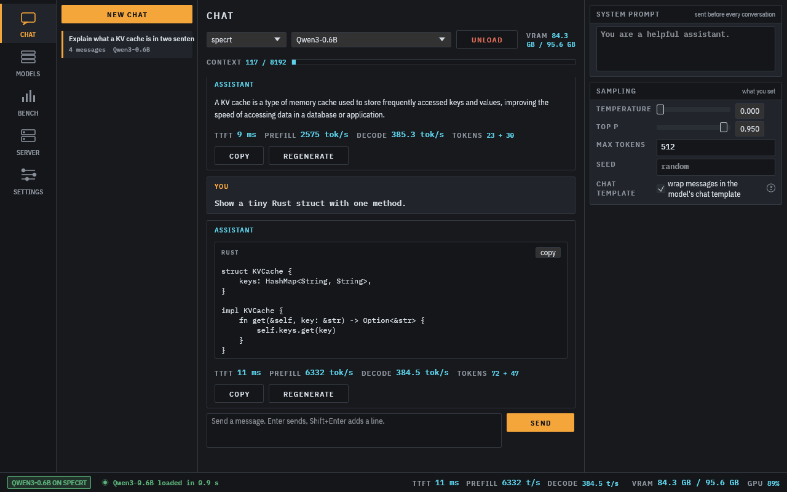
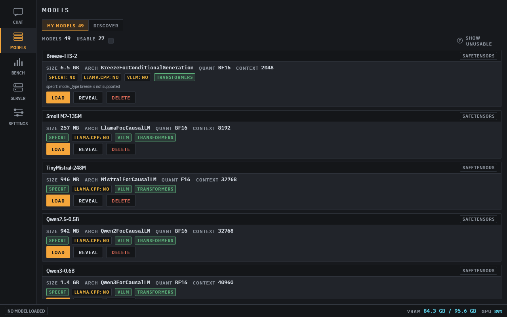
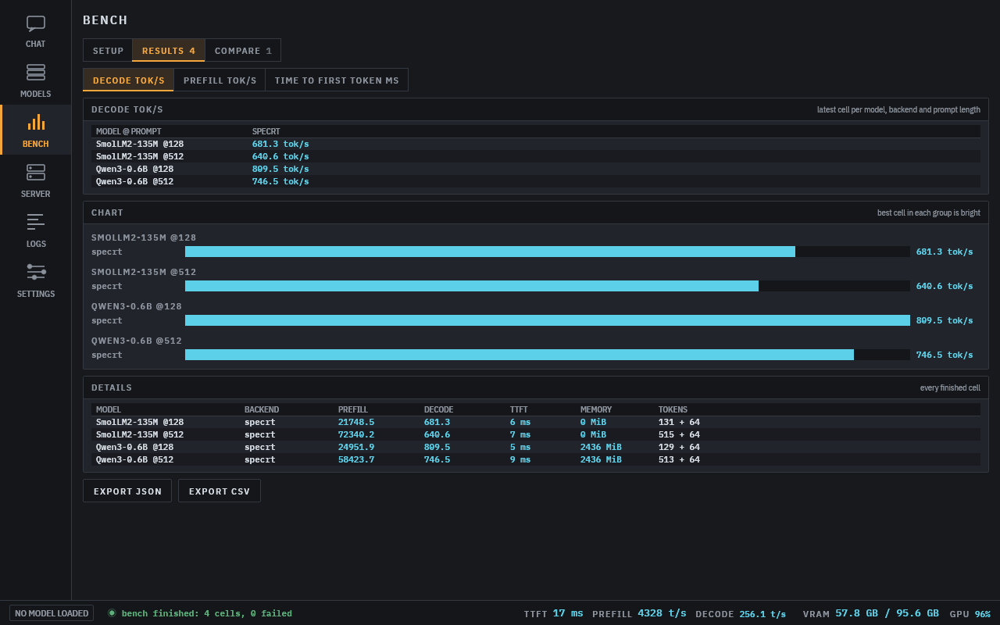

# inference-bench

A local LLM app that runs models on its own CUDA engine, `specrt`, in process: chat, a model
library, an OpenAI-compatible server, and a benchmark that measures prefill and decode tokens per
second, time to first token and peak memory, with the real error when a model cannot run
(including "unsupported architecture").

Part of the [bench suite](https://github.com/v0l/bench-suite), a launcher that installs, updates
and starts it alongside the other bench tools.

## Engine and bench targets

Every model the app loads, chats with or serves runs on the native engine in `crates/specrt`, where
a new model is a TOML file. It runs on a dedicated thread inside the process: a cancelled reply stops
at the next decode chunk, and a CUDA error, an out of memory or a panic in the engine comes back as an
error on that request instead of taking the app down.

Other engines (llama.cpp, vLLM, LM Studio, any OpenAI-compatible server) are only benchmark targets,
for comparing their speed with ours. They are never used for chat, the library or the server.

The name `specrt` is kept on purpose, even though it is the only engine the app runs. It names the spec-driven design and appears in saved results, the `specrt_ctx` setting and docs/spark-matrix.md, so renaming would break result history and old settings for no visible gain. Revisit only if the engine stops being spec-driven; the plan then is crate `inference-bench-engine`, a serde alias for `specrt_ctx` and `specrt` accepted as an alias in stored results.

## Command line

```
inference-bench run --model Qwen/Qwen3-0.6B --prompt-file p.txt
inference-bench bench --target openai:http://localhost:8080 --label llama.cpp --model qwen3 --prompt-len 512
inference-bench batch --model Qwen/Qwen3-0.6B --sizes 1,4,16
inference-bench matrix matrix.toml
inference-bench logit-diff --model crates/specrt/specs/qwen3-0.6b.toml --reference out/qwen3-0.6b.ref.json
```

`run` always uses the native engine. `bench`, `batch` and `matrix` take a target: `native` (the
default) or `openai:URL`. A matrix file lists targets as `kind = "native"` or `kind = "openai"`.
`logit-diff` compares our prompt logits with a reference written by
`crates/specrt/scripts/reference.py`.

Results are saved as JSON in the data directory (`INFERENCE_BENCH_DIR` to move it) and shown by
`inference-bench-ui`.

## Window

`inference-bench-ui` is a local LLM app in the style of LM Studio, with a rail of five tabs. Every
slow call (disk scan, Hugging Face, model load, generation, bench, GPU poll) runs off the UI thread.

- Chat: pick a model, load or unload, streaming markdown replies, system prompt,
  temperature, top-p, seed and max tokens, a context bar, chat template toggle, saved conversations,
  regenerate, stop and copy. TTFT, prefill and decode tok/s sit under each reply and in the status bar
  with VRAM and GPU load (`nvidia-smi`).
- Models: everything found in the Hugging Face cache, GGUF folders and `crates/specrt/specs`, with
  size, architecture, quant, context length and a supported or unsupported architecture badge for
  the native engine and for the llama.cpp and vLLM bench targets. Search and download from Hugging Face with resume, reveal in folder, delete.
- Bench: pick models, targets (the native engine and the bench targets from settings) and prompt lengths, run with live progress, results table and charts,
  compare two runs, export JSON or CSV.
- Server: an OpenAI-compatible server (`/v1/models`, `/v1/chat/completions`, `/v1/completions`) for
  the loaded model, with port, API key, LAN toggle and a request log.
- Settings: native engine context length, bench target URLs and API keys (`settings.json`, mode
  0600), model folders, Hugging Face token.





## Layout

- `crates/core`: the in-process native engine thread, the `Target` trait and the OpenAI-compatible bench target, `RunResult`, matrix runner, logit diff, settings, library, result store.
- `crates/cli`: the `inference-bench` command.
- `crates/ui`: the `inference-bench-ui` window.
- `crates/server`: the OpenAI-compatible server for the native engine. See `docs/server.md`.
- `crates/specrt`: the native CUDA runtime and its `specrt::Engine` API. See its README.

Measured comparisons with llama.cpp and vLLM on a DGX Spark are in `docs/spark-matrix.md`.
