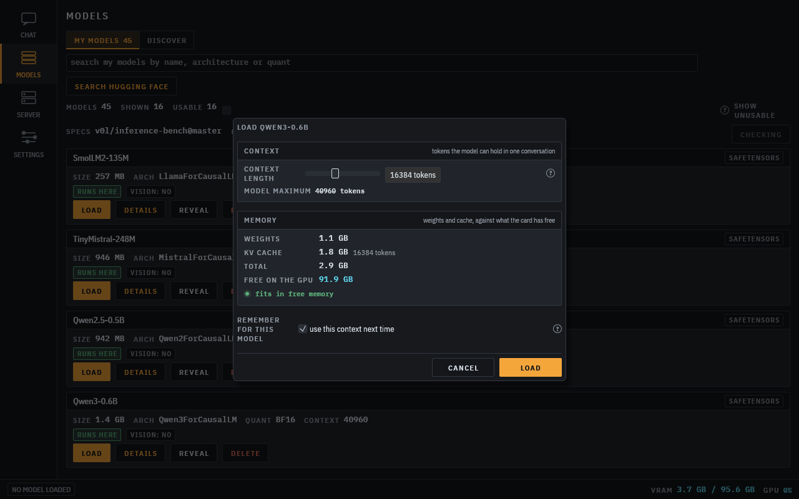
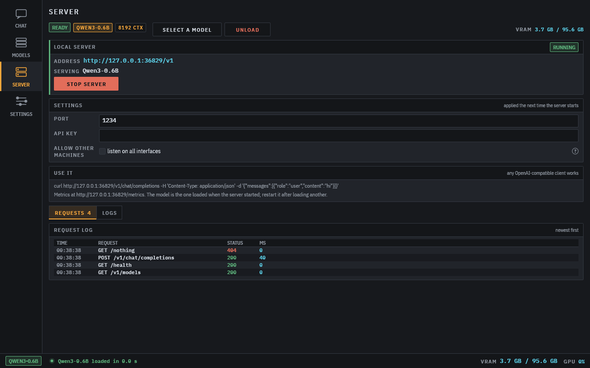

# inference-bench

A local LLM server and desktop app, in the style of LM Studio, on its own CUDA engine, `specrt`:
a searchable model library with downloads, chat, and an OpenAI-compatible server. A new model is a
TOML spec, and specs update themselves from GitHub.

Part of the [bench suite](https://github.com/v0l/bench-suite), a launcher that installs, updates
and starts it alongside the other bench tools.

## Engine

Every model the app loads, chats with or serves runs on the native engine in `crates/specrt`, where
a new model is a TOML file. It runs on a dedicated thread inside the process: a cancelled reply stops
at the next decode chunk, and a CUDA error, an out of memory or a panic in the engine comes back as an
error on that request instead of taking the app down.

Comparing our speed with llama.cpp or vLLM on the same model and hardware is dev tooling, not an app
feature: it lives in the `inference-bench bench`, `batch` and `matrix` commands below and has no
screen. The app never talks to another engine.

The name `specrt` is kept on purpose, even though it is the only engine the app runs. It names the spec-driven design and appears in saved results and docs/spark-matrix.md, so renaming would break result history for no visible gain. Revisit only if the engine stops being spec-driven; the plan then is crate `inference-bench-engine` and `specrt` accepted as an alias in stored results.

## Command line (dev tooling)

```
inference-bench run --model Qwen/Qwen3-0.6B --prompt-file p.txt
inference-bench bench --target openai:http://localhost:8080 --label llama.cpp --model qwen3 --prompt-len 512
inference-bench batch --model Qwen/Qwen3-0.6B --sizes 1,4,16
inference-bench matrix matrix.toml
inference-bench logit-diff --model crates/specrt/specs/qwen3-0.6b.toml --reference out/qwen3-0.6b.ref.json
```

`run` always uses the native engine. `bench`, `batch` and `matrix` take a target: `native` (the
default) or `openai:URL`. A matrix file lists targets as `kind = "native"` or `kind = "openai"`.
`logit-diff` compares our prompt logits with a reference written by
`crates/specrt/scripts/reference.py`.

Results are saved as JSON in the data directory (`INFERENCE_BENCH_DIR` to move it).

## Window

`inference-bench-ui` follows the LM Studio flow: pick a model, load it with per-load options, then
chat with it or serve it. A rail of four pages; every slow call (disk scan, Hugging Face, model load,
generation, GPU poll) runs off the UI thread. The design and its reasons are in
`docs/gui/redesign.md`.

- Models: everything found in the Hugging Face cache, GGUF folders and the spec files, with size,
  architecture, quant, context length and whether the engine runs it. A search field filters the list
  by name, architecture, quant or format as you type, and "discover" searches Hugging Face and
  downloads with resume. Each spec says where it came from (your folder, updated from GitHub, or
  built in). Details show what the model is and what loading it costs: layers, parameters, memory
  against context, every spec field.
- Load dialog: opened from a model card, the details page or the model bar. A context length slider
  runs from 512 to the model's own maximum, with weights, kv cache and state against the GPU's free
  memory, red when it does not fit. The choice is remembered per model.
- Chat: a model bar with the loaded model, its context, a searchable picker, unload and VRAM. Streaming
  markdown replies, system prompt, temperature, top-p, seed and max tokens, a context bar, saved
  conversations, regenerate, stop and copy, image and video attachments for vision models. TTFT,
  prefill and decode tok/s sit under each reply and in the status bar.
- Server: the same model bar, an OpenAI-compatible server (`/v1/models`, `/v1/chat/completions`,
  `/v1/completions`) for the loaded model with port, API key and LAN toggle, a request table and the
  app logs. Multi-host placement from `server.toml` in the data folder is shown read only.
- Settings: model folders, Hugging Face token and spec updates (`settings.json`, mode 0600).

## Spec updates

Model specs (`crates/specrt/specs/*.toml`) update themselves from this repository on GitHub, so a
model added here after you installed shows up and runs without reinstalling. Every build carries a
snapshot of the specs, so a first run offline works too. `inference-bench specs status`, `specs
update` and `specs rollback` manage them from the command line. How it works, the settings and what
goes over the network: `docs/specs-update.md`.






## Layout

- `crates/core`: the in-process native engine thread, the `Target` trait and the OpenAI-compatible target used by the dev bench commands, `RunResult`, matrix runner, logit diff, settings, library, result store.
- `crates/cli`: the `inference-bench` command.
- `crates/ui`: the `inference-bench-ui` window.
- `crates/server`: the OpenAI-compatible server for the native engine. See `docs/server.md`.
- `crates/specrt`: the native CUDA runtime and its `specrt::Engine` API. See its README.

Measured comparisons with llama.cpp and vLLM on a DGX Spark are in `docs/spark-matrix.md`.
