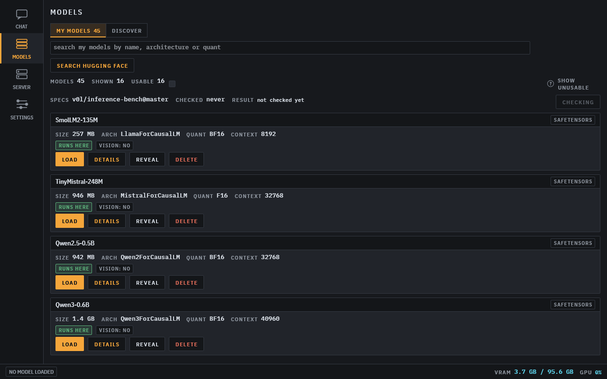
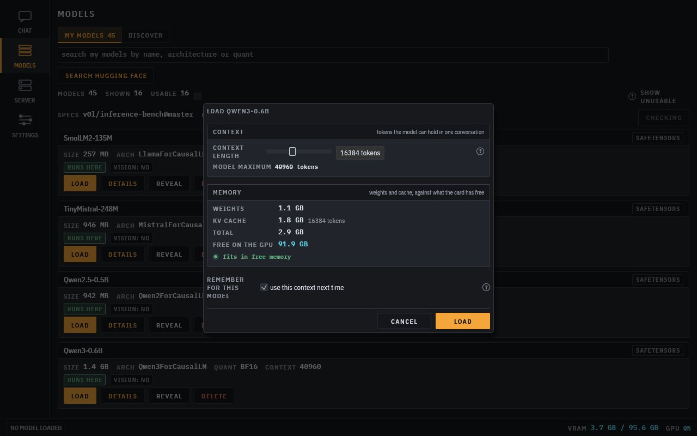
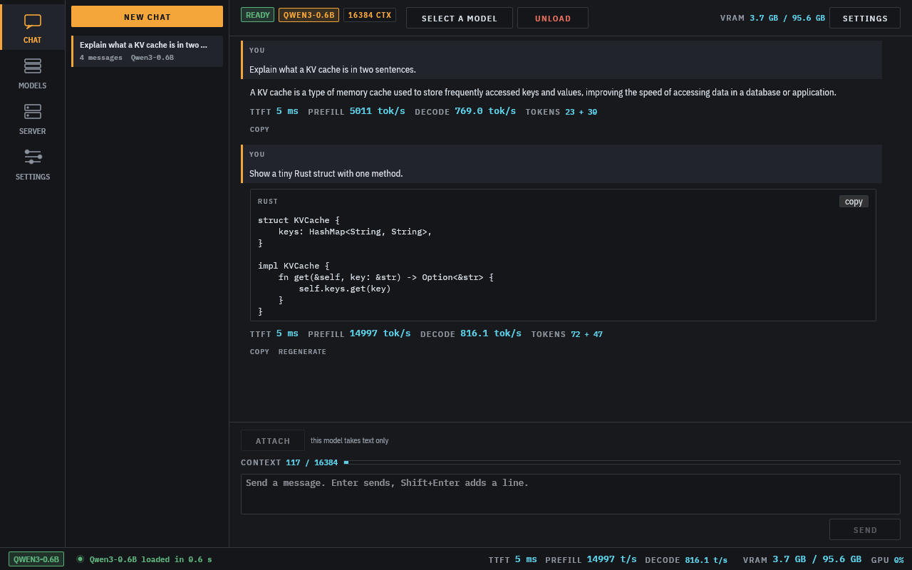
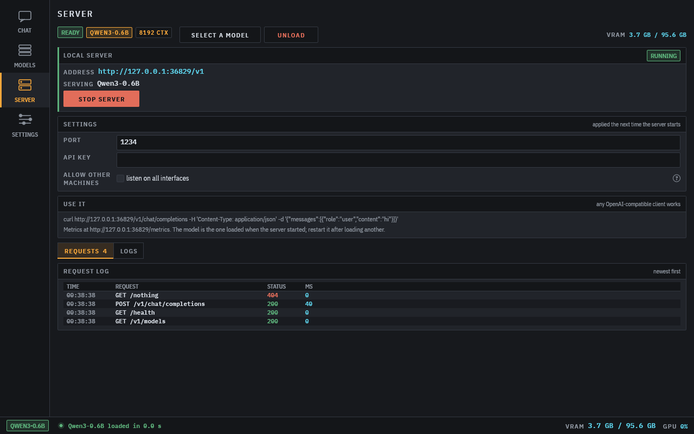

# The desktop app

`crates/ui` (`inference-bench-ui`): an LM Studio style app on egui and egui_bench. Benchmarking is not a feature of the app; the `bench`, `batch` and `matrix` commands stay in the CLI as dev tooling. Every answer about whether a model runs and how it loads comes from specrt (`Spec::from_hf_config`, the family files, `wgsl::unsupported`, `solve`), never from a list in `crates/core` or `crates/ui`; a test holds every specrt fixture config supported by the library.

## Rail and pages

Rail: **chat**, **models**, **server**, **hardware**, **settings** (`crates/ui/src/shell.rs`). The chat tab reads **generate** when an image or video model is loaded and **voice** for a duplex model. The loaded model and its memory show on every page: a model bar on chat and server (`modelbar.rs`) and the status bar at the bottom.

| Page | Code | What it does |
|---|---|---|
| Chat | `chat.rs` | conversation with the loaded model, attachments for vision models, thinking toggle, tool calls |
| Generate | `imagegen.rs`, `videogen.rs` | prompt, size presets, seed, steps, guidance, n, progress and stop, result grid; see [diffusion.md](diffusion.md) |
| Voice | `duplex.rs` | websocket address and CLI line for a duplex model; see [speech.md](speech.md) |
| Models | `models.rs`, `detail.rs`, `crates/core/src/library.rs`, `crates/core/src/discover.rs` | the library (search across name, repo, architecture, quant and format; a runs here chip from specrt), discover (Hugging Face search, file lists, resumable downloads), the model detail (summary, layers, vision tower, parameters and memory against context) |
| Load dialog | `load.rs` | profile, the solved plan ([distributed.md](distributed.md)), context and memory estimates, every engine option from `options::schema()` grouped and folded, remember per model |
| Server | `server.rs`, `serving.rs`, `sessions.rs`, `logs.rs` | start and stop the OpenAI server, settings for the next start, the request table, logs, the pipeline panel, saved sessions |
| Hardware | `hardware.rs` | GPUs and links, cluster sharing, pairing, running a cluster |
| Settings | `settings.rs` | model folders, Hugging Face token, spec updates ([../guides/specs-update.md](../guides/specs-update.md)), default profile, theme, data folder |

## Load dialog

Opened from the model bar, a library card or the detail. It solves on every change (`specrt::solve`) and shows the strategy, reasons and any shortfall; moving the slots or KV controls pins them. Load hands the engine exactly the `Solved` it showed (`EngineChoice.solved`), and the engine fails with the stage error rather than fall back. The dialog says "will span N GPUs" when the memory it sizes is more than the largest GPU and blocks the load when the planner says it does not fit. Options come from `options::schema()`, so a new engine option appears without UI work. The choice is kept per model in `settings.json` (`model_engine`), with `default_profile` for new models. Image, video and duplex models open their own load pages.

## Hardware and clusters

Everything on the page comes from specrt: GPUs and links from `specrt::hardware::probe` (driver API, `cuDeviceCanAccessPeer`; a wgpu probe without CUDA), peers from `cluster::decode_peer`, plans from `solve`.

- This machine: host, RAM, one line per GPU (name, arch, total and free memory, bandwidth and TFLOP/s as the planner sees them), the link between each pair, network interfaces usable for mDNS.
- Cluster: "Share this machine's GPU in a cluster" (off) with an interface picker; it announces `_inference-bench._tcp` with a versioned TXT record (`v=2`, host, app version, busy, serving, one `gN` entry per GPU).
- Pair: the peer shows an 8 character code (5 minutes, 3 tries). It feeds a SPAKE2 exchange (`crates/specrt/src/pairing.rs`); the cluster key from `cluster.key` then travels under ChaCha20-Poly1305 with an HKDF key, never over mDNS. Peers must be paired before they can be selected.
- Run a cluster: pick a model, context and parallel requests, include or exclude each GPU; the preview shows stages per `host / GPU n`, layer ranges, memory, step and hop time, the slowest stage. Load starts local stage servers and asks each peer for its stages, then loads through `[placement.remote]`.

## Tests

`crates/ui/src/tests.rs`, `tests_images.rs`, `tests_video.rs`, `tests_duplex.rs` drive pages through the egui test harness at desktop and phone widths; tests marked `renders with wgpu` write screenshots to `SHOTS=<dir>`. Load, placement and hardware changes are verified by running the real app in a headless sway, loading through the dialog and reading `nvidia-smi --query-compute-apps`.
