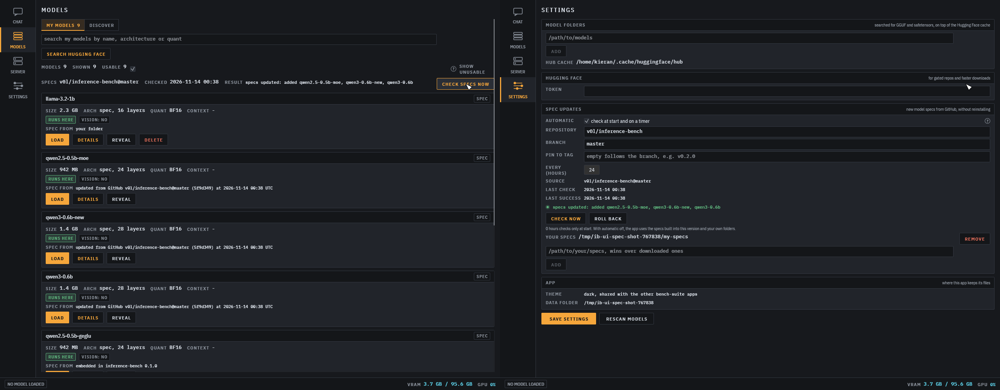

# Spec updates

Model specs are the TOML files in `crates/specrt/specs`. The app keeps a copy of them in its data
directory and refreshes it from GitHub, so a model added to the repository after you installed
shows up and runs without reinstalling.



## Where specs come from

Specs are read from four places. When two have a spec with the same `name`, the earlier one wins.

1. Your spec folders: `spec_folders` in `settings.json` (Settings, "your specs"), or
   `[specs].folders` in the server config. Nothing ever writes to these.
2. The updated cache: `<data dir>/specs/current/`, filled from GitHub.
3. The snapshot built into the binary: every build embeds `crates/specrt/specs` (a build script in
   `crates/specrt` writes an `include_str!` table). It is written out to
   `<data dir>/specs/embedded/` so the engine can load it by path. A first run with no network
   uses it.
4. The folders of a source checkout (`crates/specrt/specs` beside the executable), for development.

The data dir is the platform data dir (`~/.local/share/inference-bench` on Linux,
`~/Library/Application Support/inference-bench` on macOS, `%APPDATA%\inference-bench` on Windows),
or `INFERENCE_BENCH_DIR`. The Models page shows where each spec came from: "your folder", "updated
from GitHub owner/repo@branch (commit) at time", or "embedded in inference-bench version".

## How an update works

The repository is never downloaded. An update asks the GitHub API for three small things:

1. `GET https://api.github.com/repos/<repo>/commits/refs/heads/<branch>` (or `refs/tags/<tag>` when
   pinned) with `Accept: application/vnd.github.sha`, which answers the commit id as plain text.
   It carries `If-None-Match` set to the ETag of the last answer (kept in `<data dir>/specs/.etag`).
   An unchanged branch answers 304 and nothing else happens. No git is needed.
2. `GET .../contents/crates/specrt/specs?ref=<commit>`: the directory listing.
3. `GET .../contents/crates/specrt/specs/<name>.toml?ref=<commit>` with
   `Accept: application/vnd.github.raw+json`, once per spec file.

Every file is read from the same commit, so a push in the middle of an update cannot mix two
generations. The limits:

- Each spec file is capped at 256 KiB, the listing at 4 MiB, all the specs together at 8 MiB, and
  the whole update at 60 s. The size of the rest of the repository does not matter.
- Only regular files directly in `crates/specrt/specs/` whose name is a plain `name.toml`
  (letters, digits, `-`, `_`, `.`, no leading dot, no `..`) are taken. Everything else in the
  listing, including directories, links and other file types, is ignored and never fetched.
- Each spec is parsed with the engine's own spec check before it is accepted. A spec that fails
  to parse is skipped with a warning, and the previous copy of that spec is kept.
- Nothing downloaded is executed or interpreted beyond the TOML.

An unauthenticated client gets 60 API requests an hour from one IP address. A check costs
2 + (number of specs) requests only when the branch moved, and 1 when it did not.

The accepted specs are written to a new folder beside the cache, which then replaces `current/`
with a rename. A failed update (network error, bad answer, nothing that parses) leaves `current/`
as it was. The replaced folder moves to `<data dir>/specs/.history/`, which keeps the last 3
generations. Every update is logged with `tracing`: which specs were added, updated, removed and
skipped, and the commit.

A model that is loaded keeps running on the spec it was loaded with. The engine reads the spec once
at load time; an update applies the next time the model is loaded. The model list refreshes when an
update lands.

## Specs for a newer engine

A spec may set `min_engine`, a whole number that defaults to 0. The engine reads specs up to
`SPEC_FORMAT` (`crates/specrt/src/spec.rs`, currently 4: 2 added hybrid linear attention, 3 added `quant = "fp8_block128"`, 4 added `quant = "fp8_channel"` and `[mlp] quant = "nvfp4_g16"` with `quant_until`). A spec with a higher `min_engine` is
listed with "needs a newer inference-bench" and cannot be loaded; the app never tries to parse the
parts it does not know. When a spec needs an engine change, raise `SPEC_FORMAT` in the same commit
and set `min_engine` in the spec to the new value, so older apps skip it instead of failing.

## When it runs

- The app: in a background thread a moment after start, then when the interval has passed (it
  looks every 10 minutes whether a check is due). "check specs now" on the Models page (which shows one word, `ok`, `up to date` or `failed`, with the full text on hover) and "check
  now" in Settings run one straight away, even when automatic updates are off.
- `inference-bench-server`: at start in the background, then every `update_hours`. The server never
  waits for it to start serving. `/admin/specs` returns the state, and `/metrics` has
  `inference_specs_checks_total{result}` and `inference_specs_last_success_timestamp_seconds`.
- The CLI: `inference-bench specs update`. The CLI does not update on its own.

## Settings

| App (`settings.json`) | Server (`[specs]`) | Default | Meaning |
| --- | --- | --- | --- |
| `specs_auto_update` | `auto_update` | `true` | Check at start and on the timer |
| `specs_repo` | `repo` | `v0l/inference-bench` | GitHub repository |
| `specs_branch` | `branch` | `master` | Branch to follow |
| `specs_tag` | `tag` | empty | Pin to a tag instead of the branch |
| `specs_update_hours` | `update_hours` | `24` | Hours between checks, 0 checks at start only |
| `spec_folders` | `folders` | none | Your own specs, which win over the others |
| | `data_dir` | the data dir | Where the cache lives |
| | `url` | `https://api.github.com` | A mirror with the same API layout |

`INFERENCE_BENCH_SPECS_URL` overrides the download host for the app and the CLI.

With automatic updates off, the app makes no request and uses the embedded snapshot plus your
folders (and whatever an earlier update left in the cache).

## Privacy

One HTTPS request to GitHub per check, at most once per interval. It sends no identifiers, no
token, no list of your models and no settings. GitHub sees the IP address and the ureq user agent,
as for any download.

## Commands

```
inference-bench specs status     # source, last check and result, cache commit, and where each spec comes from
inference-bench specs update     # fetch now
inference-bench specs rollback   # go back one generation from .history
```

Settings has a "roll back" button that does the same as `specs rollback`.

## Release check

`crates/specrt/tests/spec.rs` `the_embedded_snapshot_equals_the_specs_folder` compares the
embedded table with `crates/specrt/specs` and parses every entry. The release workflow runs it
before building, so a release always embeds the specs at its tag.
